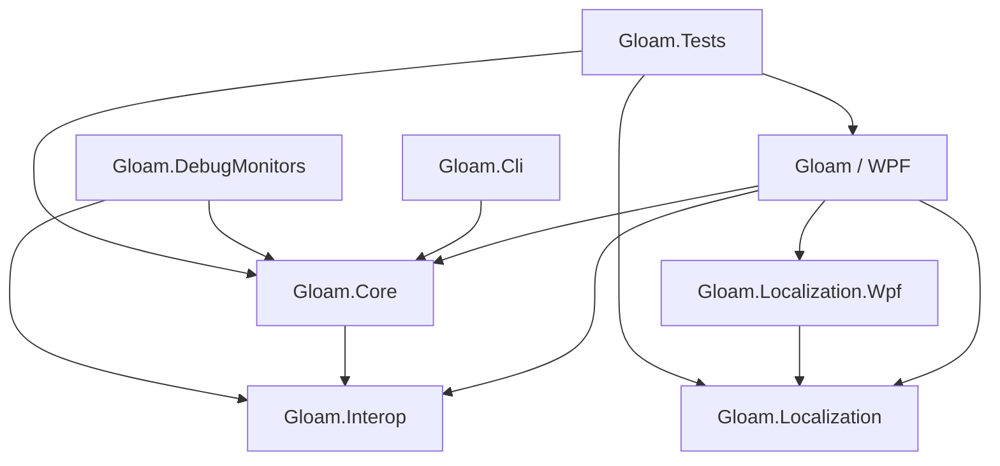

# Gloam 代码结构分析

分析日期：2026-10-31（Asia/Shanghai）  
源码位置：`D:\WorkSpace\gloam`  
Git 基线：`27063342e427b485dd1427dbb22cf66f13d494c4`  
主程序项目版本：`1.10.0`（以项目文件为准，不代表线上最新发布版本）

本文面向接手开发和日常维护，基于当前工作区源码、项目文件、测试与构建配置做静态分析。未执行构建、测试、安装、发布或真实显示器校准；下述测试说明表示已有验证机制，不表示本次验证已通过。

## 1. 总体判断

Gloam 是 C# / .NET 10 的 Windows WPF 托盘应用，主要处理 Windows HDR 模式下 SDR 内容的 gamma 校正，同时提供夜间模式、按应用/游戏生效的画面策略，以及色度计校准。

其结构可以概括为：**WPF 功能模块负责交互，Core 负责策略和色彩计算，Interop 封装 Windows API；校准流程拥有独立的测量和验证链路。** 它不是 Web 服务，也没有由 `package.json` 驱动的前端应用；该文件只服务于静态站点白皮书的构建工具。

当前解决方案包含 8 个工程：7 个源码工程和 1 个测试工程。排除 `bin/obj` 后，`src/` 与 `tests/` 合计有 311 个 `.cs`/`.xaml` 文件。`Gloam.Core/Calibration` 有 57 个直接子文件，是理解项目时应重点阅读的子系统。

## 2. 仓库地图

```text
gloam/
├─ src/
│  ├─ Gloam/                    WPF 主程序
│  │  ├─ Shell/                启动入口、依赖装配、主窗口
│  │  ├─ Features/
│  │  │  ├─ Tray/              托盘、热键、显示器菜单、提示
│  │  │  ├─ Dashboard/         状态总览与配置入口
│  │  │  ├─ Calibration/       校准窗口、会话协调、报告、HDR 色块
│  │  │  ├─ GameLab/           游戏配置与独立窗口
│  │  │  ├─ NightMode/         夜间时间线与设置交互
│  │  │  └─ Settings/          显示器设置
│  │  ├─ Infrastructure/      对话框、主题、平台集成
│  │  ├─ Controls/            跨功能控件
│  │  ├─ Resources/i18n/       内嵌翻译目录
│  │  └─ Themes/, Fonts/      样式与字体资源
│  ├─ Gloam.Core/             策略、显示器、LUT、配置、夜间模式
│  │  └─ Calibration/         测量、建模、校准文件与验证
│  ├─ Gloam.Interop/          Windows P/Invoke 与底层接口
│  ├─ Gloam.Localization/     平台无关的本地化引擎
│  ├─ Gloam.Localization.Wpf/ XAML 适配
│  ├─ Gloam.Cli/              无头计算与诊断命令
│  ├─ Gloam.DebugMonitors/    显示器诊断入口
│  └─ Gloam.sln
├─ tests/Gloam.Tests/         xUnit、WPF 回归、实测数据夹具
├─ docs/                     设计、操作、审计和发布说明
├─ site/                     静态官网和白皮书
├─ scripts/                  产物检查、更新检查、白皮书生成
├─ deploy/                   站点部署配置与说明
├─ ai/memory-bank/           现有任务过程记录
├─ .github/workflows/        构建、验证和站点部署
├─ Directory.Build.props     全局编译和分析器规则
├─ Directory.Packages.props  NuGet 版本集中管理
├─ global.json               SDK 选择规则
└─ package.ps1               本地安装包构建
```

根目录已有 `ARCHITECTURE.md`，在本次分析开始时处于未跟踪状态。本文保留该文件，以源码核对后的概览作为独立导入文档。`ai/memory-bank` 是仓库内的历史任务记录，与 Codex 资料库是两个不同位置。

## 3. 工程依赖与边界

下图箭头表示“引用/依赖”，由调用方指向被引用工程。



| 工程 | 目标框架 | 核心职责 |
|---|---|---|
| Gloam | net10.0-windows，WPF | UI、组合根、系统托盘与平台集成 |
| Gloam.Core | net10.0-windows | 领域策略、色彩计算、测量、持久化及部分平台操作 |
| Gloam.Interop | net10.0 | DisplayConfig、DXGI、GDI、User32、WCS 等互操作声明 |
| Gloam.Localization | net10.0 | 翻译加载、查找与语言策略，不引用 WPF |
| Gloam.Localization.Wpf | net10.0-windows，WPF | 翻译绑定、标记扩展和字体适配 |
| Gloam.Cli | net10.0-windows | LUT 检查与色彩计算工具 |
| Gloam.DebugMonitors | net10.0-windows | 显示器诊断工具 |
| Gloam.Tests | net10.0-windows，WPF | 核心逻辑、UI 与工程约束回归 |

这里需要区分“无 UI 依赖”和“跨平台”：Core 没有引用主 UI 工程，但依然面向 Windows；Interop 的目标框架虽然是 `net10.0`，其中 Windows API 的运行仍有平台要求。

UI 按功能垂直组织，功能内可以同时存在窗口、ViewModel 和协调器。它不是所有行为都通过 ViewModel 的严格 MVVM：部分复杂校准逻辑仍在 code-behind。主 UI 工程通过项目级 global using 导入功能命名空间，这种便利只适用于同一 UI 模块，不应替代跨工程的明确边界。

## 4. 启动与运行模型

主要入口是 `src/Gloam/Shell/Program.cs`，由项目中的 `StartupObject` 指定。

1. `Program.Main` 首先执行 Velopack 钩子，处理安装、更新和卸载事件。
2. 如果有 `--smoke` 参数，进入独立的启动检查路径。
3. 常规启动使用 `Local\Gloam-SingleInstance` 互斥锁，避免多个实例同时修改 gamma 和配置。
4. 创建 WPF `App`，进入 `App.OnStartup`。
5. 迁移旧品牌数据目录，然后初始化日志、检查并提取 ICM 资源。
6. `App.ConfigureServices` 创建 DI 容器，注册设置、显示器、应用策略、本地化等长期服务。
7. 恢复主题并发布本地化对象，在首个窗口解析 XAML 前完成语言和字体设置。
8. 修复启动项和旧高级颜色 profile 关联，再创建 `MainWindow`。

`MainWindow` 承载应用生命周期与托盘相关工作，不应按普通内容主窗口理解。退出时容器释放其拥有的长期服务，定时器、前台应用监听与 UI 订阅需要相应清理。

**维护约束：** 不应任意重排启动步骤。数据迁移必须先于创建新数据目录的日志初始化；主题、本地化和高级颜色迁移影响首次显示及首次应用校正。

源码入口：`Shell/Program.cs`、`Shell/App.xaml.cs`、`Shell/MainWindow.xaml.cs`。

## 5. 四条主要业务链路

### 5.1 每显示器 gamma 与夜间校正

```text
托盘 / Dashboard / 设置 / 热键 / 状态事件
    → GammaApplyService.RequestApply
    → 解析显示器配置、夜间策略、应用排除和游戏会话
    → LatestValueCoalescer：每显示器合并最新请求
    → DispwinRunner.ApplyGamma
    → LutGenerator / ColorAdjustments / NativeGammaRamp
    → 原生 gamma ramp；必要时回退到 ArgyllCMS dispwin
```

`GammaApplyService` 是普通运行期校正的集中策略入口。它将快速滑动产生的请求合并，设置每显示器 250 ms 的写入间隔下限，并每 10 秒调用 ramp guard 回读、恢复被其他程序或驱动覆盖的曲线。

需要避免将上述链路与校准 profile 安装混为一谈：Windows MHC2 文件生成、安装和关联还有独立的校准路径，并不全部经过普通 gamma ramp 写入。

### 5.2 夜间调度

`NightModeService` 根据固定时间或太阳位置计算状态，相关数学由 `SunCalculator`、`ColorAdjustments` 等承担。感知夜间模式涉及 CAT16 色适应、色温的 mired 空间过渡；Ultra Night 与光谱、melanopic 指标还有额外计算链路。

调度变化最终引起显示器重新应用策略。手动覆盖、应用排除和 Gameplay Lock 会改变有效状态，所以新增调度能力应进入统一策略解析，不能只在控件里独立设置硬件曲线。

### 5.3 Game Lab

`AppDetectionService` 提供应用观察，`GamerModeCoordinator` 结合配置规则、应用状态及窗口覆盖范围解析目标显示器，再将会话策略交给应用服务。相关数据结构与画面意图主要位于 `GamerMode.cs`。

它同时支持前台匹配及显式启用的后台运行匹配。Gameplay Lock 用于冻结会话中的调度派生色温；它需要与手动夜间控制、紧急恢复及配置变更共同工作。

UI 入口在 `Features/GameLab`，策略逻辑应优先在 Core 中阅读与维护。

### 5.4 色度计校准

```text
CalibrationSetupWindow / CalibrationLaunchCoordinator
    → 设备与配置预检
    → CalibrationSessionCoordinator / CalibrationStateManager
    → 进入 bypass，暂时隔离日常校正
    → CalibrationOrchestrator 调度色块与测量
    → ColorimeterService / SpotreadSession 调用 ArgyllCMS
    → 建模、LUT 或 MHC2 profile 生成
    → CalibrationProfileInstaller 安装与关联
    → CalibrationVerifier / VerificationCoordinator 复测
    → 报告与历史记录
```

这是一张职责图，具体步骤会随 SDR/HDR、预设和校准目标变化。关键区别是测量、模型预测和安装后验证是不同阶段；报告中的验证结果应以实际复测为依据。

`CalibrationStateManager` 的 bypass 状态会在请求入口、异步执行、硬件写入前及 ramp guard 中重复检查。重复检查用于处理状态在排队或计算期间变化的竞争，不能只保留第一次检查。

## 6. 校准模块如何阅读

| 领域 | 主要入口 | 阅读重点 |
|---|---|---|
| 会话状态 | CalibrationStateManager | bypass、设备标识与恢复生命周期 |
| 测量调度 | CalibrationOrchestrator、PatchSetGenerator | 稳定等待、重测、暂停/取消、进度 |
| 仪器通信 | ColorimeterService、SpotreadSession | 外部进程协议、测量结果与异常 |
| 色彩数学 | ColorMath、ColorTypes、Cam16Ucs | 坐标系、单位、变换与误差计算 |
| 曲线与 LUT | Lut3DGenerator、HdrMhc2LutBuilder | SDR/HDR 分支与输出表示 |
| 迭代修正 | ClosedLoopCorrector、DriftCompensator、HdrColorMatrixRefiner | 闭环收敛、面板漂移和修正边界 |
| Profile 输出 | Mhc2ProfileBuilder、CalibrationProfileInstaller、AdvancedColorProfileAssociation | 文件格式、安装、Windows 关联 |
| 验证与报告 | CalibrationVerifier、UncertaintyBudget、CalibrationReport | 复测结果、误差来源和报告数据 |

UI 侧还包含 `HdrRefinementCoordinator`、`VerificationCoordinator` 与报告构建相关类型。修改报告功能前，应先确认变化属于数据计算、测量协调还是展示，避免继续扩大窗口类职责。

## 7. 数据、资源与外部依赖

- `SettingsManager` 管理设置；`SettingsPersistence` 负责格式探测、读写和替换，`SettingsNormalization` 处理归一化。读取涉及大小限制、旧结构迁移与新 schema 检测，不应简单地“解析失败就重置覆盖”。
- 用户数据主要位于 `%LOCALAPPDATA%\Gloam`；Velopack 安装目录是 `%LOCALAPPDATA%\GloamApp`。源码目录不是实际运行时数据目录。
- ICM 模板既作为嵌入式资源，也复制到输出目录；这与安装目录权限及部署镜像行为有关。
- UI 翻译位于 `Resources/i18n/*.json`；可通过用户数据目录的 `i18n` 覆盖。核心翻译引擎与 WPF 适配分开维护。
- ArgyllCMS 通过独立进程参与测量和部分曲线应用。进程调用、下载、校验、超时与输出解析是校准可靠性的一部分。
- CommunityToolkit.Mvvm、Hardcodet.NotifyIcon.Wpf、Microsoft.Extensions.DependencyInjection 和 Velopack 分别支撑 MVVM、托盘、DI 与安装更新；具体 NuGet 版本统一在 `Directory.Packages.props` 中声明。

## 8. 测试、构建与发布

SDK 规则由 `global.json` 给出：最低 `10.0.100`，`rollForward: latestFeature`，不接受预发布。分析器配置固定为 `10.0-recommended`。严格构建通过 `GloamStrictBuild=true` 启用警告即错误，并对 NuGet 安全公告警告有单独配置。

现有验证体系包括：

1. 色彩数学与 LUT 单元测试：传递函数、色彩适应、HDR、曲线、误差等。
2. 状态与持久化回归：设置恢复、profile 切换、请求合并、服务释放等。
3. Golden replay：以真实面板测量夹具回放约束计算结果，不等于本轮真实硬件验证。
4. WPF 测试：窗口布局、本地化、报告分页和 UI 行为，部分测试需要桌面环境。
5. 工程化检查：严格构建、启动 smoke、CLI LUT 检查、依赖漏洞扫描、更新 feed 与发布产物校验。

测试程序集关闭并行执行，以控制进程级主题、语言和静态路径等共享状态。

常用命令（本次未执行）：

```powershell
dotnet run --project src/Gloam
dotnet build src/Gloam.sln -c Release -p:GloamStrictBuild=true
dotnet test src/Gloam.sln -c Release
dotnet run --project src/Gloam -- --smoke --data-dir C:\temp\gloam-smoke
dotnet run --project src/Gloam.Cli -- check-lut 2.2 200 --algorithm perceptual --temp-k 2700 --json -
.\package.ps1 -Version X.Y.Z
```

CI 主要在 `.github/workflows/build.yml` 中，站点部署在 `deploy-site.yml` 中。`site/whitepaper.html` 是白皮书源文件；数学资源和 Markdown 有对应生成脚本，不宜直接修改生成结果。

## 9. 结构优势与维护关注点

### 已具备的优势

- 主要程序集依赖方向清晰，UI 不被 Core 反向引用。
- 功能目录让窗口、交互和协调代码可按业务定位。
- 普通校正策略集中，并有合并、限速、恢复与测量隔离机制。
- 平台无关的本地化引擎可以独立验证。
- 校准数学由专门测试和真实测量夹具提供回归约束。

### 建议后续处理

以下是静态结构观察及建议，不是已确认的运行故障：

| 观察 | 影响 | 建议 |
|---|---|---|
| 报告和校准窗口的 code-behind 承担较多职责 | 单次修改涉及 UI、仪器和报告，理解成本高 | 按测量操作、报告模型和展示拆分；保留会话独占约束 |
| GammaApplyService 汇集夜间、应用排除与游戏策略 | 功能增长会扩大策略组合数量 | 先明确输入快照与优先级，再考虑提取纯策略解析 |
| HdrPatchRenderer 位于 UI 工程 | 平台渲染与窗口代码边界不够独立 | 按真实窗口/渲染依赖评估抽取位置，避免只为目录整齐搬迁 |
| 夜间地点检测使用明文 HTTP | 该请求的传输未受 HTTPS 保护 | 核实服务能力并替换受保护的接口；调用位于 NightModeScheduleControl.xaml.cs |
| docs/project-structure.md 仍称“五个工程加测试” | 与当前解决方案 8 个工程不符 | 将工程清单与 CLI、诊断工具的定位同步 |
| 历史任务记录与当前源码并非同一快照 | 旧版本号、测试数和待办可能误导维护者 | 以项目文件、解决方案和当前测试输出为准，并保留历史记录的时间上下文 |

## 10. 接手与扩展路线

建议先读 `README.md` 和 `docs/project-structure.md`，再读 `Shell/Program.cs`、`Shell/App.xaml.cs` 理解生命周期；随后沿 `TrayViewModel → GammaApplyService → DispwinRunner → LutGenerator` 阅读普通应用链路。涉及校准时再进入会话协调器、编排器、profile 安装和验证。

新增功能时：

1. UI 放入 `Features/<Name>`，将可独立计算或验证的策略放入 Core。
2. 在组合根显式注册所需服务，不把功能逻辑堆进 App。
3. 输出校正复用既有策略和执行路径，保持 bypass、取消和设备隔离约束。
4. UI 文案进入翻译目录；主题资源使用稳定的绝对 pack URI。
5. 根据实际改动运行对应测试；Core 逻辑和校准数学遵循贡献指南的更高验证要求。

校准数学改动应先增加捕获现状的测试，再改变行为；如果影响白皮书描述，同步修改白皮书并重新生成派生文件。未做硬件测量时，应明确说明。

## 11. 主要依据与分析边界

本次直接核对了以下关键来源：

- `src/Gloam.sln` 与 8 个 `.csproj`：工程清单、目标框架和直接依赖。
- `Shell/Program.cs`、`Shell/App.xaml.cs`：入口、DI 与初始化顺序。
- `GammaApplyService.cs`、`DispwinRunner.cs`、`LatestValueCoalescer.cs`：应用策略、限速、写入与恢复机制。
- `Calibration/CalibrationStateManager.cs`、`CalibrationOrchestrator.cs`：测量隔离和编排职责。
- `SettingsPersistence.cs`：输入约束、兼容性与持久化职责。
- `GamerModeCoordinator.cs`、`NightModeService.cs`：游戏会话和夜间状态入口。
- `Directory.Build.props`、`Directory.Packages.props`、`global.json`、CI 配置和测试资产。
- `README.md`、`CONTRIBUTING.md`、`docs/project-structure.md` 与工作区已有 `ARCHITECTURE.md`。

未逐行审计全部源码，未将已有报告中的每项风险视为本次确认结论。本文不评价线上 CI 是否通过、不提供真实设备精度结论，也不把项目版本号视为实际发布状态。未来工程结构变化时，应优先更新目录地图、依赖图和相应业务链路。
